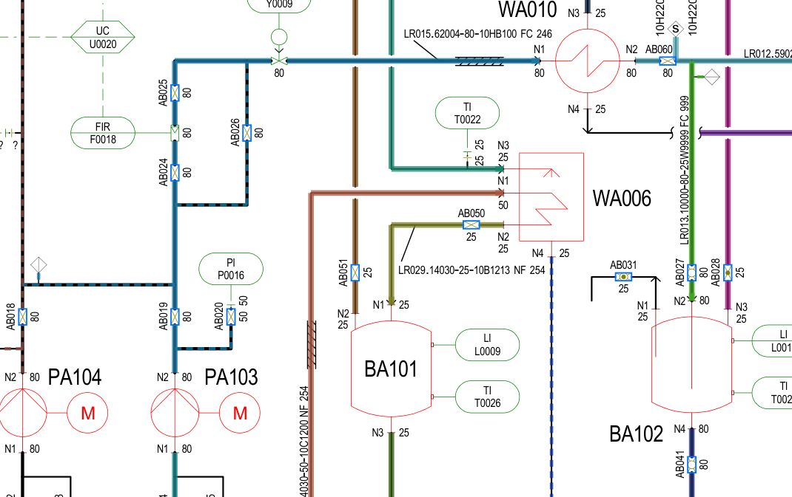

# operon-pid: from CAD P&IDs to a plant model you can query, checked against the owner's own lists

A P&ID exported from CAD (SmartPlant, AutoCAD Plant 3D and similar) is a vector PDF: the text is real text and every pipe is a line segment. This turns such a drawing into a structured plant model with:
- equipment, instrument loops, valves and lines, each with its full line spec;
- which line each valve sits on;
- which equipment each line runs between.

It then scores the result against the owner's own equipment, instrument, line and valve lists for the same drawings.

The test drawings are two connected P&IDs that Covestro contributed to the public DEXPI test cases (CC BY 4.0, see [data/dexpi/NOTICE.md](data/dexpi/NOTICE.md)). The answer key is Covestro's SmartPlant export for the same plant: equipment, instrument, line and valve lists. It's an independent record of what each drawing should contain.

## Results

Main sheet UER-1234567 (column KA002, 5 vessels, 6 pumps, 5 heat exchangers). Full tables for both sheets are in [reports/EVAL.md](reports/EVAL.md).

| What | Result |
|---|---|
| Equipment | 16/16, no false positives |
| Instrument loops and their function codes (FRC, LIC, ...) | 40/40, codes all correct |
| Valves | 73/74 (the missing one has no tag on the drawing) |
| Lines | 45/48 (the 3 missing have no label on this sheet) |
| Line specs read from labels: fluid, DN, PN, piping class, gasket, valve class | 264/264 fields match the line list |
| Valve on the right line, where the valve's run carries the line label | 32/33 |
| Valve on the right line, label inherited from the parent run | 24/27 |
| Valves whose run can't be traced to any label | 11 of 71 |
| Line-to-equipment links found, of those in the line list | 37/42 |
| Line-to-equipment links that are correct, of those reported | 37/39 |

Every tag that was missed is not written anywhere on its page. The report checks this against the full page text.

One apparent spec mismatch turned out to be a reducer. Lines with a reducer carry two sizes in the list (LA01-LR043 is listed as DN 25 and 50), and each label shows the local size, so the scorer accepts any listed value.



Each colour is one line. Solid means the line's label sits on that run; dashed means the label was inherited from the run it branches off. Blue boxes are matched valves. Full sheets: [sheet 1](reports/UER-1234567-overlay.png), [sheet 2](reports/UER-2345678-overlay.png).

## Ask it

```
$ operon-pid ask data/dexpi/C08/UER-1234567.pdf "What connects PA103 and WA010?"
TA99-LR015: fluid 62004, DN 80, PN 10, class HB100, gasket FC, valve class 246. Ends at TA99-PA103, TA99-WA010.

$ operon-pid ask data/dexpi/C08/UER-1234567.pdf "What valves are on LR015?"
Valves on TA99-LR015: TA99-AB019 (line label on its run), TA99-AB020 (inherited from the run it branches off),
TA99-AB024 (line label on its run), TA99-AB025 (line label on its run), TA99-AB026 (inherited from the run it branches off).

$ operon-pid ask data/dexpi/C08/UER-1234567.pdf "What lines are at BA101?"
Lines at TA99-BA101: TA99-LR028 (line label on its run); TA99-LR029 (line label on its run); TA99-LR032 (line label on its run).
```

Each answer says how a connection was found, so an engineer can tell a traced label from an inference.

## How it works

1. **Read the sheet** ([drawing.py](src/operon_pid/drawing.py)). SmartPlant draws each object class in its own style:
   - pipes are solid black (0.96, 1.44 or 2.88 pt);
   - equipment is red;
   - valves are olive;
   - instrument bubbles and signal lines are green.

   That sorts the main sheet's 5,181 segments without recognising a single symbol. The title block, revision box and equipment tables are located from their headings and excluded.
2. **Find tags** ([tags.py](src/operon_pid/tags.py)), using the owner's tagging scheme:
   - equipment are the large two-letter-three-digit labels;
   - an instrument bubble is a function code stacked over a loop number;
   - line labels read `[subprocess-]LR015.62004-80-10HB100 FC 246`, parsed into fluid, DN, PN, piping class, gasket and valve class;
   - valves are `A` + letter + three digits.

   A tag written as `LA01-...` belongs to the other subprocess.
3. **Trace pipe runs** ([topology.py](src/operon_pid/topology.py)):
   - Pipes are horizontal or vertical. Diagonal strokes in pipe style are label leaders.
   - Segments meeting at a corner form one run. At a tee only the straight-through pair continues, and the branch starts a new run.
   - Pipes stop at the edges of in-line symbols, so facing ends on the same axis within 45 pt are joined, as is every pipe end touching a valve symbol.
   - A label belongs to the parallel pipe beside it, or to the pipe its leader points to.
   - An unlabelled branch inherits the label of the run it leaves, but only when exactly one label is that close. This is kept as a separate, separately scored tier.
   - A run end within a nozzle's length (24 pt) of an equipment outline links that line to the equipment.
4. **Score** ([evaluate.py](src/operon_pid/evaluate.py)) against the lists ([truth.py](src/operon_pid/truth.py)), and **answer questions** ([query.py](src/operon_pid/query.py)) over the model ([model.py](src/operon_pid/model.py)).

## What has been checked

- **12 tests pass.** They cover label parsing, the tee and bridging rules on hand-built geometry, label-to-pipe attachment, the answer-key counts, and regression floors for the scores above.
- **The topology tests catch breakage.** With the tee rule disabled, two tests fail: the hand-built tee case, and sheet 1's line-to-equipment links, which go from 39 reported to 82, mostly wrong.

## Limits

- **Not a held-out result.** The rules and thresholds (nozzle reach, bridge gap, label distance) were developed while looking at these two sheets. The next check is a drawing it hasn't seen; DEXPI's reference P&ID (C01) is the obvious one.
- **Vector drawings only.** Scanned drawings need OCR or a vision model to get the same text and geometry. That path isn't built.
- **The tag patterns are Covestro's scheme.** In a deployment they are per-owner configuration.
- **Inherited labels can be wrong when a line has no label of its own.** LR034 isn't labelled on the drawing, so its valves AB015 and AB016 inherit LR001, which the valve list contradicts.
- **Instruments aren't connected to lines or equipment yet.** That needs signal lines and in-line elements traced.
- **Questions are rule-based,** because no LLM was available here. The model is plain JSON ([reports/UER-1234567.model.json](reports/UER-1234567.model.json)), so an LLM with tool access to it could take free-form questions.

## Run it

```bash
uv sync
uv run operon-pid report                                   # both sheets: reports/EVAL.md, results.json, models, overlays
uv run operon-pid extract data/dexpi/C08/UER-1234567.pdf --out model.json
uv run operon-pid ask data/dexpi/C08/UER-1234567.pdf "Which line is AB020 on?"
uv run pytest
```
