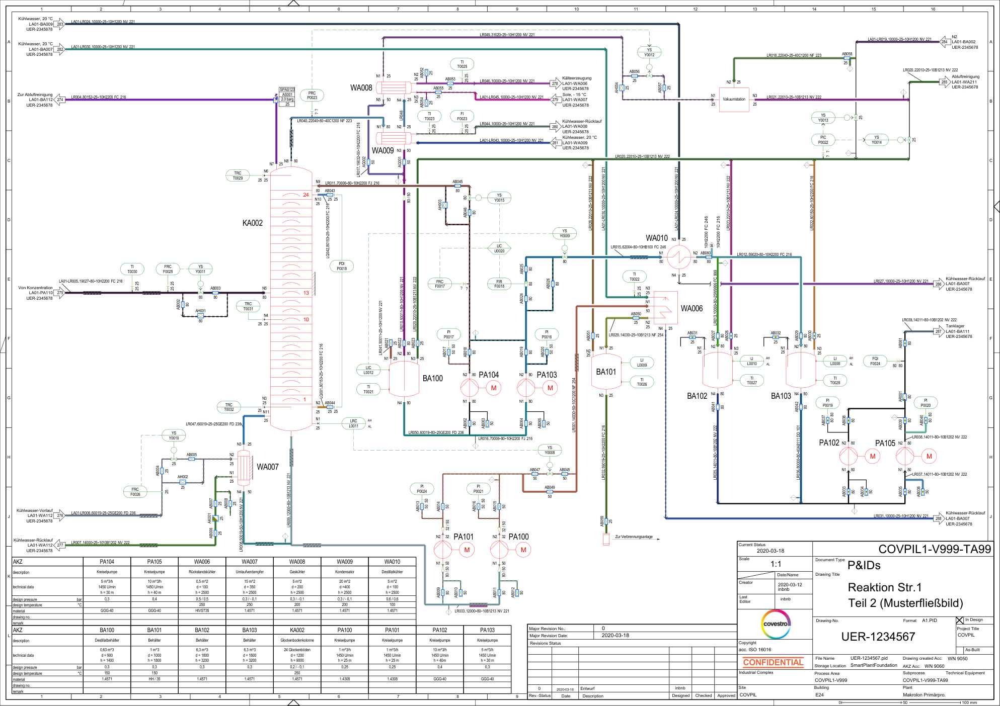
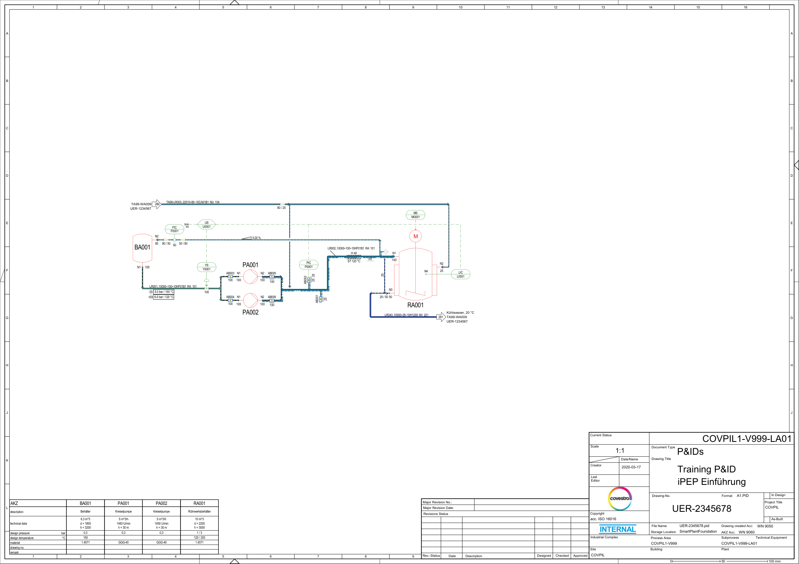

# Extraction results: Covestro C08 P&IDs (DEXPI test cases)

Scored against Covestro's own equipment, instrument, line and valve lists exported from the same SmartPlant model. Generated by `operon-pid report`.

## UER-1234567 (subprocess TA99)

| Item | In the list for this sheet | Found | Correct | Precision | Recall |
|---|---|---|---|---|---|
| equipment | 16 | 16 | 16 | 100% | 100% |
| instrument | 40 | 40 | 40 | 100% | 100% |
| line | 48 | 45 | 45 | 100% | 94% |
| valve | 74 | 73 | 73 | 100% | 99% |

Missed, and the tag is not written anywhere on the page: LA01-LR004, TA99-LR003, TA99-LR034, TA99-AB001

| Field | Correct |
|---|---|
| instrument function | 40/40 (100%) |
| line fluid | 44/44 (100%) |
| line dn | 44/44 (100%) |
| line pn | 44/44 (100%) |
| line piping_class | 44/44 (100%) |
| line gasket | 44/44 (100%) |
| line valve_class | 44/44 (100%) |

| Connection | Result |
|---|---|
| Valve on line, label on its own run | 32/33 (97%) |
| Valve on line, inherited from parent run | 24/27 (89%) |
| Valve on line, not resolved | 11 |
| Line ends at equipment: found of expected | 37/42 (88%) |
| Line ends at equipment: correct of reported | 37/39 (95%) |
| ...from labelled runs | 28/28 (100%) correct |
| ...through branch runs | 9/11 (82%) correct |
| Links on lines whose list entry has no From/To (not checkable) | 12 |

Wrong: TA99-AB011: traced TA99-LR009, list TA99-LR033; TA99-AB016: traced TA99-LR001, list TA99-LR034; TA99-AB012: traced TA99-LR009, list TA99-LR033; TA99-AB015: traced TA99-LR001, list TA99-LR034; TA99-LR001 -> TA99-PA100; TA99-LR001 -> TA99-PA101

## UER-2345678 (subprocess LA01)

| Item | In the list for this sheet | Found | Correct | Precision | Recall |
|---|---|---|---|---|---|
| equipment | 4 | 4 | 4 | 100% | 100% |
| instrument | 6 | 6 | 6 | 100% | 100% |
| line | 19 | 4 | 4 | 100% | 21% |
| valve | 6 | 6 | 6 | 100% | 100% |

Missed, and the tag is not written anywhere on the page: LA01-LR003, LA01-LR005, LA01-LR006, LA01-LR019, LA01-LR024, LA01-LR030, LA01-LR045, TA99-LR004, TA99-LR007, TA99-LR020, TA99-LR027, TA99-LR031, TA99-LR039, TA99-LR044, TA99-LR046

| Field | Correct |
|---|---|
| instrument function | 6/6 (100%) |
| line fluid | 4/4 (100%) |
| line dn | 4/4 (100%) |
| line pn | 4/4 (100%) |
| line piping_class | 4/4 (100%) |
| line gasket | 4/4 (100%) |
| line valve_class | 4/4 (100%) |

| Connection | Result |
|---|---|
| Valve on line, label on its own run | n/a |
| Valve on line, inherited from parent run | 6/6 (100%) |
| Valve on line, not resolved | 0 |
| Line ends at equipment: found of expected | 6/6 (100%) |
| Line ends at equipment: correct of reported | 6/8 (75%) |
| ...from labelled runs | 1/1 (100%) correct |
| ...through branch runs | 5/7 (71%) correct |
| Links on lines whose list entry has no From/To (not checkable) | 0 |

Wrong: LA01-LR002 -> LA01-BA001; TA99-LR003 -> LA01-RA001

